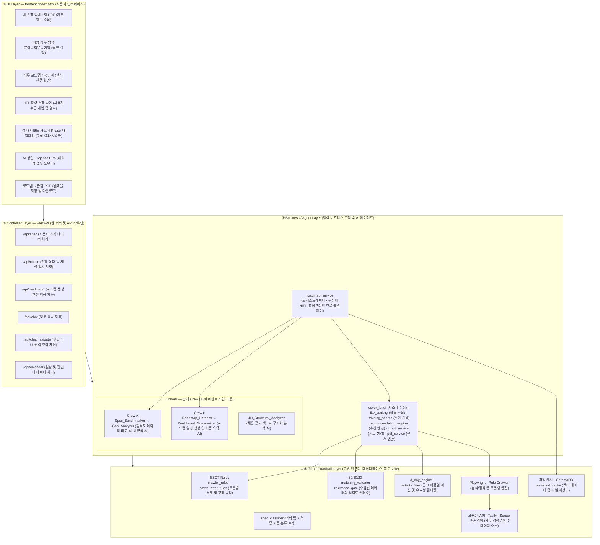
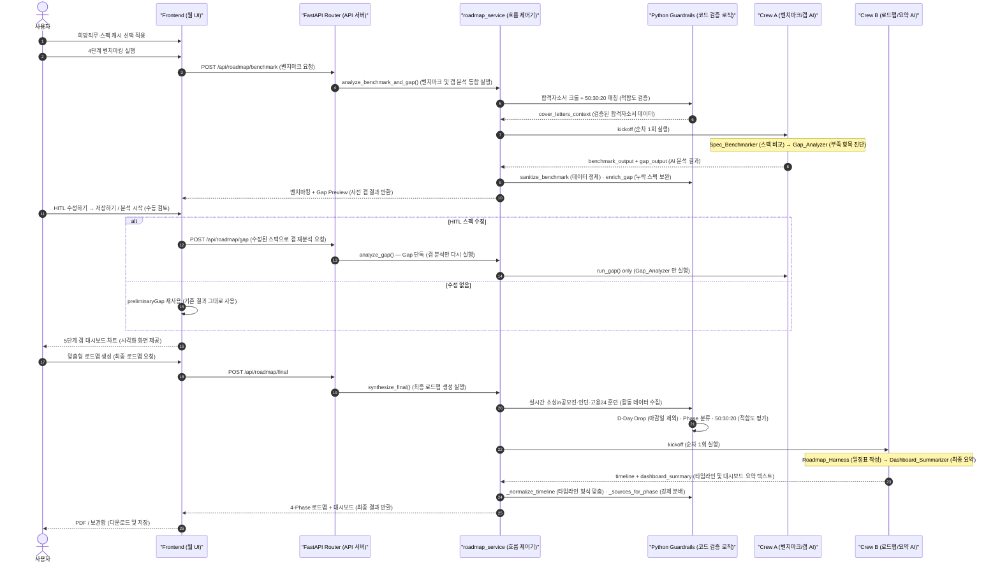
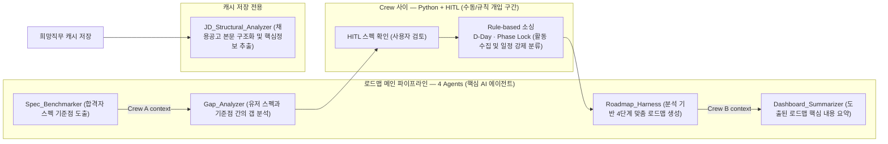
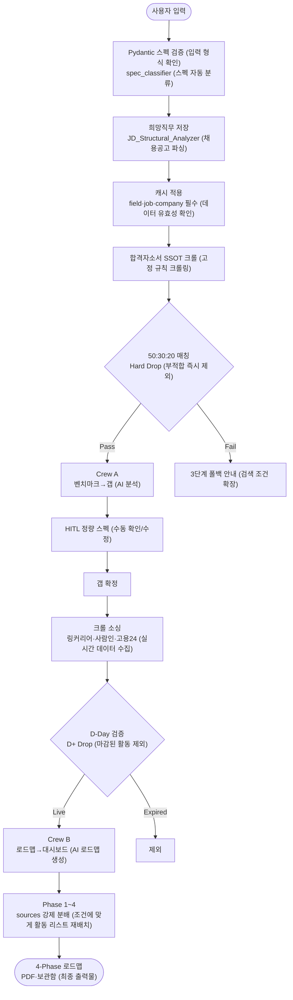
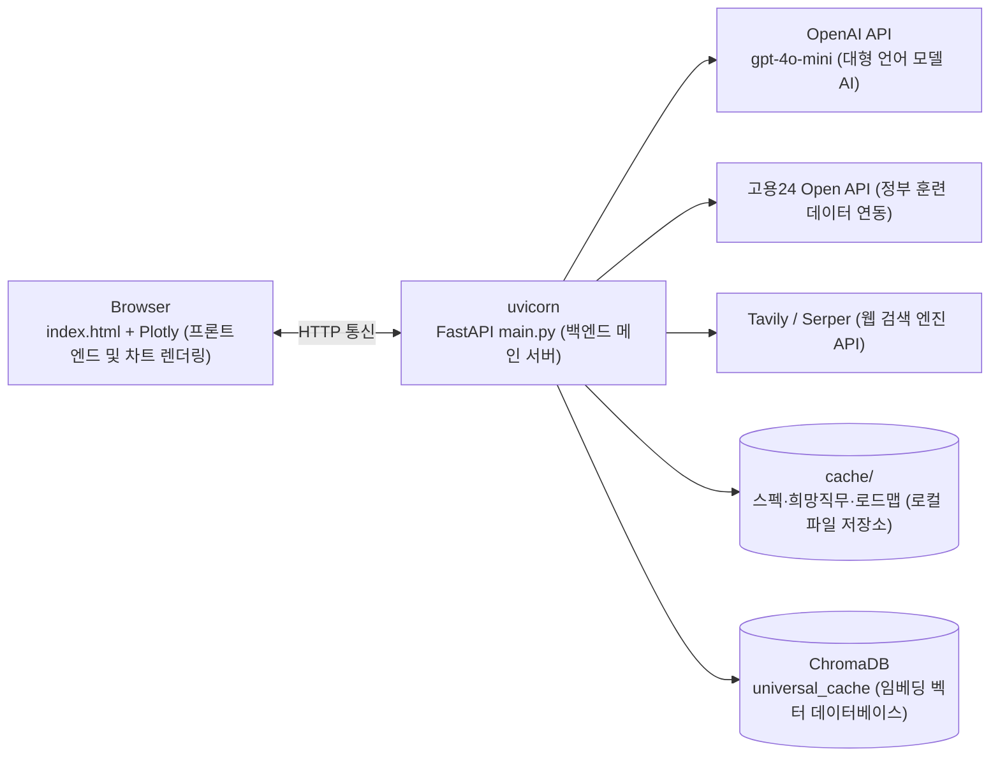

# CareerAi 시스템 아키텍처 (Mermaid)

> Mermaid 미리보기: VS Code/Cursor Mermaid 확장, GitHub, Notion, [mermaid.live](https://mermaid.live) 에 붙여넣기

---

## 1. 전체 4계층 아키텍처

---

## 2. 직무 로드맵 핵심 파이프라인 (HITL + Crew A/B)

---

## 3. CrewAI 에이전트 구성 (현재 설계)

---

## 4. 가드레일·Rule-based 적용 지점 (Python 규칙 강제 구간)

---

## 5. 배포·런타임 구성

